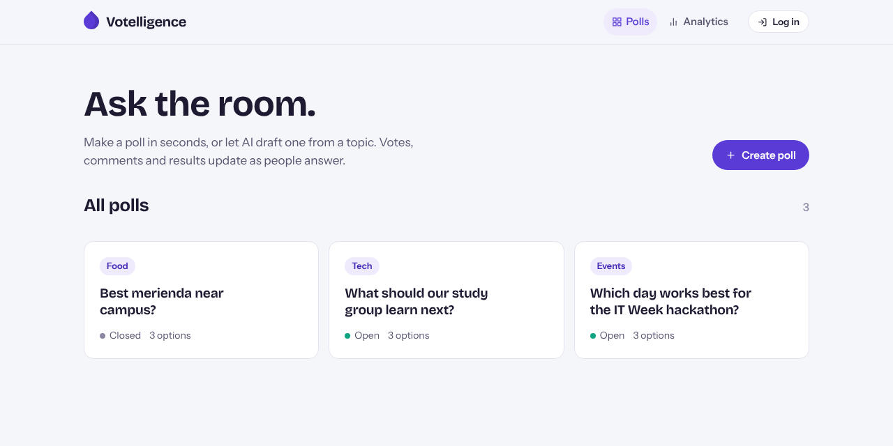
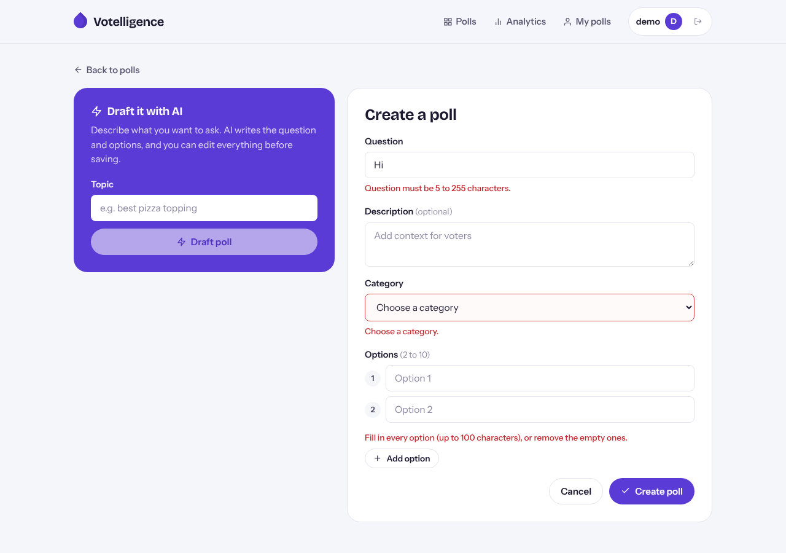
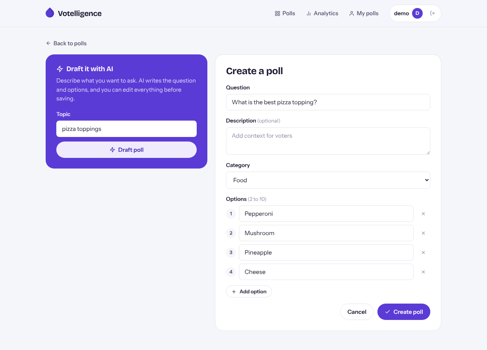
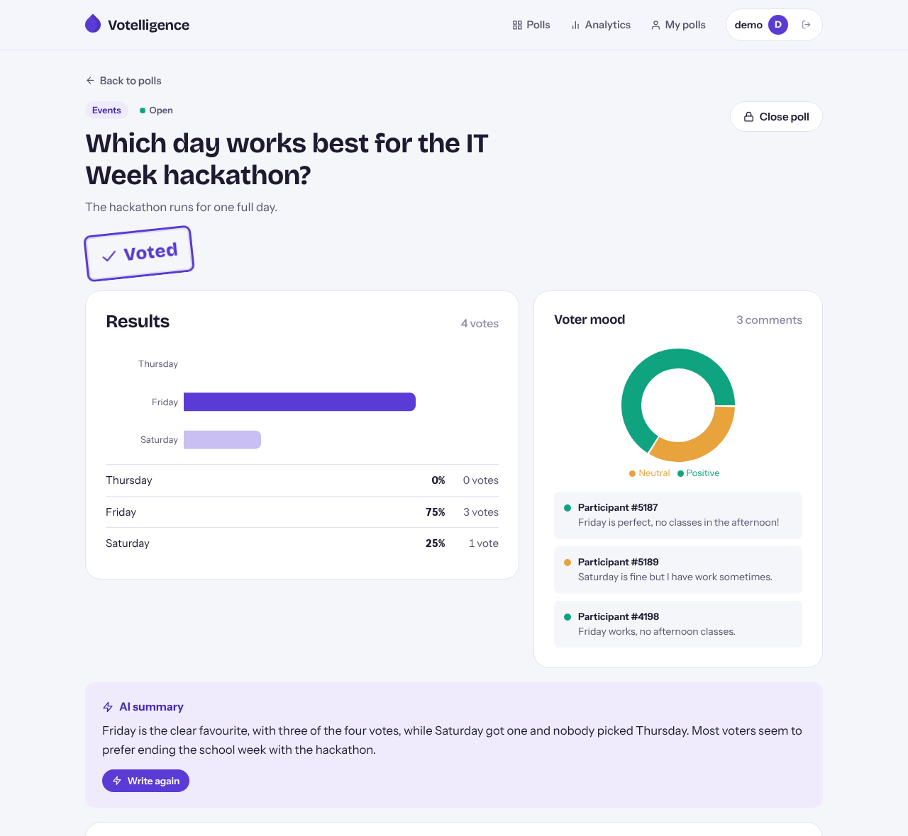
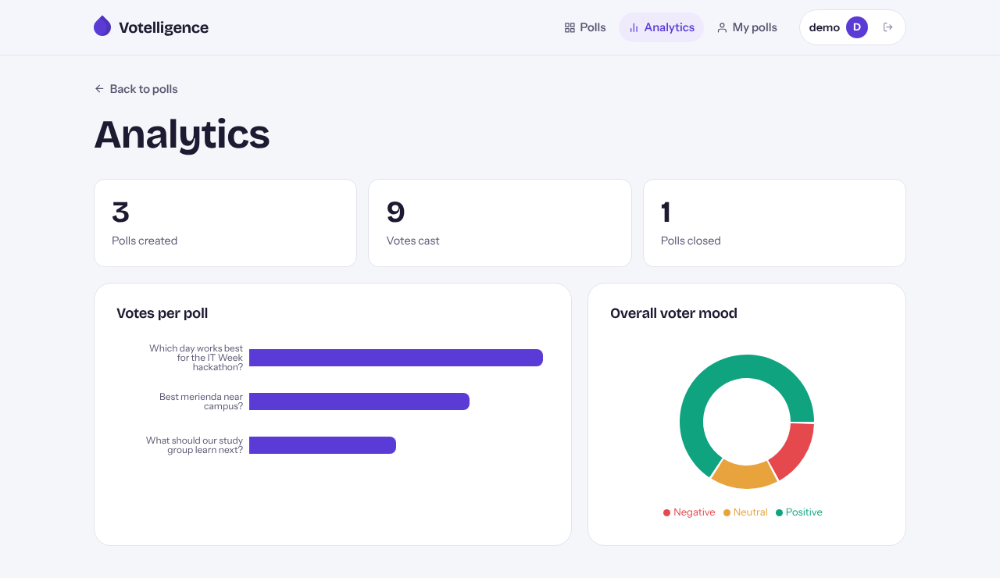
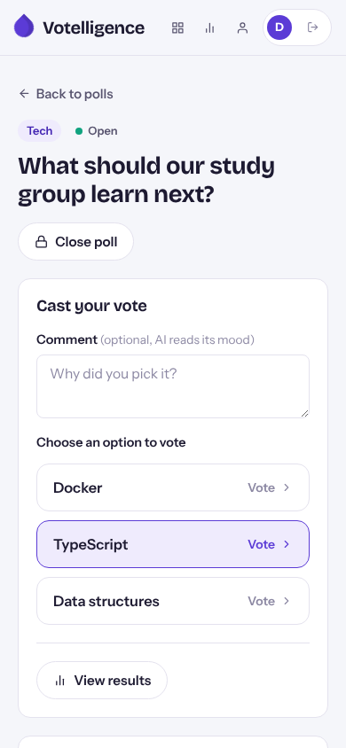

# Votelligence: AI-Powered Poll & Voting App

**Project #19: React Poll & Voting Form**

**🔗 Live demo: https://votelligence.vercel.app**
(API: https://votelligence-api.onrender.com. It runs on a free tier, so the first request after a quiet period can take about a minute while the server wakes up.)

Demo account: username `demo`, password `demo123`

Votelligence is a full-stack poll and voting app with AI built in. Logged-in users create polls (by hand, or by letting AI draft the question and options from a topic). Anyone can vote once per poll and leave an optional comment, which AI labels as positive, neutral, or negative. The results page shows charts, margins of error, a vote-burst (anomaly) warning, an AI-written summary, and an AI duplicate-option detector. All data is stored in MySQL.

```
React (Vite) ──Axios──▶ Express API ──validate──▶ MySQL
                              │
                              └──▶ Google Gemini (AI features; key stays on the server)
```

> Originally built with a Java Spring Boot + PostgreSQL backend. For this final project the backend was rewritten in **Express + MySQL** with the same endpoints, so the React frontend is the same app with the same design.

## Features

- **Create poll form** (login required): question, description, category select, 2–10 options. One state object, one `handleChange`, an error beside each field, and the form resets after saving.
- **Generate with AI**: type a topic and Gemini drafts the question and options, which you can edit before saving.
- **Voting**: one vote per voter per poll (enforced by a `UNIQUE` key in MySQL), with an optional comment.
- **AI sentiment** on comments (POSITIVE / NEUTRAL / NEGATIVE).
- **Results**: bar chart, sentiment pie chart, percentages with a 95% margin of error, and a vote-burst anomaly warning.
- **AI summary** of the results, and an **AI duplicate-option detector** (embeddings + cosine similarity).
- **Analytics dashboard**: total polls, votes, closed polls, votes per poll, and overall sentiment.
- **Accounts**: register/login with bcrypt-hashed passwords and JWT. Owners can close or delete their polls.
- Loading states, error messages (including "Cannot reach the server"), and a layout that works on phones.

## Tech Stack

| Layer | Tools |
|-------|-------|
| Frontend | React 19, Vite, React Router, Axios, Recharts, react-icons, Fontsource (fonts bundled, work offline) |
| Backend | Node.js, Express 5, cors, dotenv, bcryptjs, jsonwebtoken |
| Database | MySQL 8 (mysql2/promise connection pool) |
| AI | Google Gemini API (text generation + embeddings) |

## Folder Structure

```
Votelligence/
├── client/                         React (Vite)
│   ├── .env.example
│   └── src/
│       ├── api/
│       │   ├── axios.js            the ONE Axios instance (baseURL + interceptors)
│       │   └── index.js            all API calls
│       ├── hooks/
│       │   └── useFetch.js         custom hook: data, loading, error, refetch
│       ├── components/
│       │   ├── CreatePoll.jsx      main form (+ AI generate)
│       │   ├── PollList.jsx        list + delete
│       │   ├── PollDetail.jsx      vote, results, AI summary, close poll
│       │   ├── ResultsChart.jsx    bar chart
│       │   ├── SentimentChart.jsx  pie chart + comments
│       │   ├── DuplicateChecker.jsx
│       │   ├── AnalyticsDashboard.jsx
│       │   ├── AuthPage.jsx        login / register
│       │   └── ConfirmModal.jsx
│       ├── App.jsx                 routes + poll list state
│       └── main.jsx
├── server/                         Express API
│   ├── app.js                      middleware order + routes + start
│   ├── env.js                      loads .env first
│   ├── db.js                       mysql2 connection pool
│   ├── routes/                     pollRoutes, authRoutes, aiRoutes, analyticsRoutes
│   ├── controllers/                named route handlers
│   ├── models/                     all SQL queries (? placeholders)
│   ├── services/
│   │   ├── aiService.js            Gemini calls
│   │   └── statsService.js         margin of error, anomaly detection, sentiment counts
│   ├── validators/validators.js    server-side validation
│   ├── middleware/
│   │   ├── logger.js               custom request logger
│   │   ├── auth.js                 reads the JWT, requireLogin
│   │   ├── validateId.js           checks :id is a positive number
│   │   └── errorHandler.js         404 + error handler
│   ├── schema.sql
│   └── .env.example
├── screenshots/
└── README.md
```

## Setup

**Requirements:** Node.js 20 or newer, and MySQL 8 (XAMPP's MariaDB also works).

### 1. Create the database

Run `server/schema.sql` in MySQL Workbench, or in phpMyAdmin (Import tab), or from a terminal:

```bash
mysql -u root -p < server/schema.sql
```

This creates `votelligence_db`, four tables, sample polls, and a demo account (**username `demo`, password `demo123`**). Running it again resets the data.

### 2. Configure and run the server

```bash
cd server
npm install
cp .env.example .env        # Windows: copy .env.example .env
```

Edit `server/.env`:
- `DB_USER` / `DB_PASSWORD`: your MySQL login (XAMPP is usually `root` with an empty password)
- `JWT_SECRET`: any long random string
- `GEMINI_API_KEY`: your key from https://aistudio.google.com/apikey (optional: without it, everything except the AI buttons still works)

```bash
npm run dev
```

You should see:
```
Connected to MySQL database "votelligence_db"
API running at http://localhost:3000
```

### 3. Configure and run the client

In a second terminal:

```bash
cd client
npm install
cp .env.example .env        # Windows: copy .env.example .env
npm run dev
```

Open **http://localhost:5173**.

### Environment variables

| File | Variable | Purpose |
|------|----------|---------|
| server/.env | `PORT` | API port (3000) |
| server/.env | `DB_HOST`, `DB_PORT`, `DB_USER`, `DB_PASSWORD`, `DB_NAME` | MySQL connection |
| server/.env | `DB_SSL`, `DB_CA_CERT` | Encrypted connection for online databases (`DB_SSL=true` on Aiven) |
| server/.env | `CLIENT_ORIGIN` | Frontend URL allowed by CORS |
| server/.env | `JWT_SECRET` | Signs login tokens |
| server/.env | `GEMINI_API_KEY`, `GEMINI_MODEL` | AI features |
| client/.env | `VITE_API_URL` | Axios `baseURL` (`http://localhost:3000/api`) |

## Deployment

| Part | Host | Notes |
|------|------|-------|
| React frontend | **Vercel**: https://votelligence.vercel.app | Root directory `client`; env `VITE_API_URL=https://votelligence-api.onrender.com/api`. `vercel.json` sends every route to `index.html` so refreshing `/polls/1` works. |
| Express API | **Render** (free web service, Singapore) | Root directory `server`; build `npm install`; start `npm start`; health check `/api/health`. All `server/.env` variables are set in Render's Environment settings, with `DB_SSL=true` and `CLIENT_ORIGIN=https://votelligence.vercel.app`. |
| MySQL | **Aiven** (free plan, Asia Pacific) | Tables and sample data loaded with `node scripts/run-schema.js` (reads the connection from terminal environment variables, so the password is never saved in a file). |

No secrets are stored in the repository. They live only in local `.env` files (ignored by git) and in each host's environment settings.

## Database

| Table | Columns | Notes |
|-------|---------|-------|
| `users` | id, email, username, password_hash, created_at | email and username `UNIQUE` |
| `polls` | id, question, description, category, closed, owner_id, created_at | `category` is an `ENUM`; FK → users |
| `poll_options` | id, poll_id, text, position | FK → polls, `ON DELETE CASCADE` |
| `votes` | id, poll_id, option_id, comment, sentiment, voter_fingerprint, voted_at | `UNIQUE (poll_id, voter_fingerprint)` = one vote per voter |

## API Endpoints

Base URL: `http://localhost:3000/api`. 🔒 = needs `Authorization: Bearer <token>`.

**Required endpoints**

| Method | Path | Purpose | Status codes |
|--------|------|---------|--------------|
| GET | `/polls` | List all polls with their options | 200 |
| GET | `/polls/:id` | Get one poll | 200, 400, 404 |
| POST | `/polls` 🔒 | Create a poll | 201, 400, 401 |
| DELETE | `/polls/:id` 🔒 | Delete your poll (and its votes) | 200, 401, 403, 404 |

**Other endpoints**

| Method | Path | Purpose | Status codes |
|--------|------|---------|--------------|
| PATCH | `/polls/:id/close` 🔒 | Close your poll (UPDATE) | 200, 401, 403, 404, 409 |
| POST | `/polls/:id/votes` | Cast a vote `{ optionId, comment, voterFingerprint }` | 201, 400, 404, 409 |
| GET | `/polls/:id/has-voted?voterFingerprint=` | Has this voter voted? | 200, 400 |
| GET | `/polls/:id/results` | Counts, %, margin of error, anomaly, sentiment, comments | 200, 404 |
| GET | `/analytics` | Totals across all polls | 200 |
| POST | `/auth/register` | Create an account | 201, 400, 409 |
| POST | `/auth/login` | Log in, returns a JWT | 200, 400, 401 |
| POST | `/ai/generate-poll` | `{ topic }` → `{ question, options }` | 200, 400, 429, 502, 503 |
| POST | `/ai/analyze-sentiment` | `{ text }` → `{ sentiment }` | 200, 400, 429, 502, 503 |
| POST | `/ai/polls/:id/summary` | AI summary of the results | 200, 404, 429, 502, 503 |
| POST | `/ai/polls/:id/check-duplicate` | `{ text }` → closest option + similarity | 200, 400, 404, 429, 502, 503 |

Errors always look like `{ "error": "message" }`. Validation errors (400) also include `errors`, a `{ field: message }` object.

**Example: POST /api/polls**

```json
{
  "question": "What is the best pizza topping?",
  "description": "",
  "category": "food",
  "options": [{ "text": "Pepperoni" }, { "text": "Mushroom" }, { "text": "Pineapple" }]
}
```

### Validation rules (client and server)

| Field | Rule |
|-------|------|
| Question | required, 5–255 characters |
| Description | optional, up to 500 characters |
| Category | school, events, tech, food, sports, or other |
| Options | 2–10, each 1–100 characters, no duplicates (case-insensitive) |
| Comment | optional, up to 500 characters |
| Register | valid email, username 3–50, password ≥ 6, passwords match |

## Screenshots

| Poll list | Validation errors |
|---|---|
|  |  |

| Generate with AI | Results, AI summary, duplicate detector |
|---|---|
|  |  |

| Analytics | Mobile |
|---|---|
|  |  |

## Bonus Features

| Bonus | Where |
|-------|-------|
| **JWT login, protected routes, Axios interceptors** (+4) | `server/middleware/auth.js`, `client/src/api/axios.js` (request interceptor adds the token; response interceptor reads the server's error message) |
| **Update records** (+3): `PATCH /api/polls/:id/close` runs an `UPDATE` query | `pollController.closePoll`, `pollModel.close` |
| **Deployed online** (+3): frontend on Vercel, API on Render, MySQL on Aiven | https://votelligence.vercel.app |
| **Extra**: AI features (Gemini), statistics engine, analytics dashboard | `server/services/`, `AnalyticsDashboard.jsx` |

## Known Issues and Limitations

- One vote per voter is based on an id saved in the browser's localStorage. Clearing browser data or using another browser allows another vote. There is no login requirement for voting, by design.
- Polls cannot be edited after creation, only closed or deleted.
- The anomaly warning only appears when a poll has at least 20 votes.
- AI features need a `GEMINI_API_KEY`. Free-tier keys have rate limits, so too many AI requests return a "usage limit" message (429).
- The duplicate detector makes one embedding request per option, so it is slower for polls with many options.
- The free Render server sleeps after 15 minutes without traffic, so the first request after that takes about a minute.
- The free Aiven database powers off when it isn't used for a while. It has to be switched back on in the Aiven console (**Power on**).
- In the browser console, a failed request (e.g. the 401 from a wrong password, or the 409 from voting twice) shows as a red network line. This is the browser logging the HTTP status, not a CORS error or a React warning.

## AI Assistance Disclosure

An AI assistant (Claude) helped convert the original Spring Boot + PostgreSQL backend to Express + MySQL. The app itself also uses Google Gemini for its AI features. I reviewed the code and can explain how each part works.